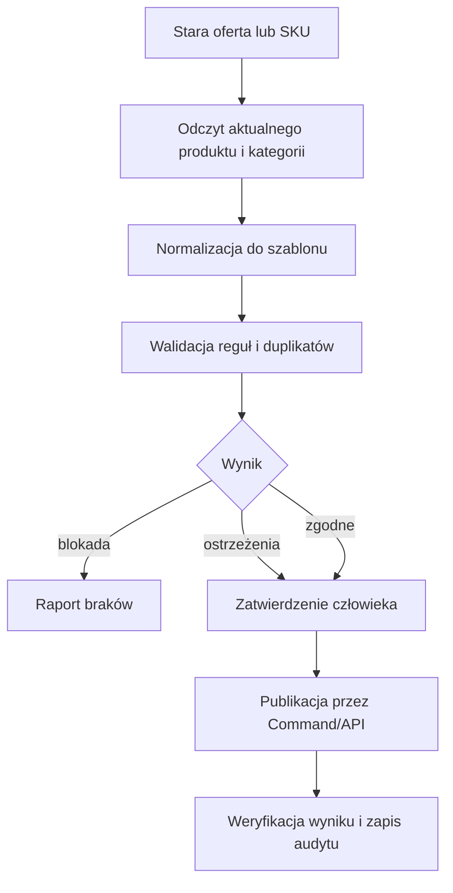

# Start tutaj

## Cel końcowy

Zbudować operatora, który potrafi:

1. wykrywać wyłączone, zakończone, błędne i nieaktualne oferty;
2. pilnować firmowych oraz platformowych reguł ofert;
3. tworzyć propozycję nowej oferty na podstawie starej, produktu i szablonu;
4. bezpiecznie publikować zatwierdzone oferty;
5. przetwarzać zamówienia i nadawać paczki bez duplikacji;
6. pozostawiać pełny ślad: co odczytał, co zaproponował, kto zatwierdził i co zmieniło API.

## Kolejność czytania dla programisty lub agenta

| Kolejność | Dokument | Odpowiada na pytanie |
|---:|---|---|
| 1 | `AGENTS.md` | Jakich zasad nie wolno łamać? |
| 2 | `BUSINESS_RULES.md` | Jakie są priorytety, koszty i bramy publikacji? |
| 3 | `docs/01-sources/source-of-truth.md` | Które dane są rozstrzygające? |
| 4 | `docs/00-overview/system-map.md` | Gdzie kończy się odpowiedzialność Allegro? |
| 5 | `docs/02-api/auth-security.md` | Jak bezpiecznie łączyć się z API? |
| 6 | `docs/03-offers/create-clone-template.md` | Jak utworzyć nową ofertę bez kopiowania błędów? |
| 7 | `docs/04-rules/offer-rules.md` | Co walidować przed publikacją? |
| 8 | `docs/06-shipments/smart-and-shipping-rates.md` | Jak spełnić Smart i policzyć dostawę? |
| 9 | `docs/06-shipments/rafish-shipping-matrix.md` | Jak dobrać wysyłkę do asortymentu? |
| 10 | `docs/05-orders/order-events.md` | Kiedy zamówienie jest gotowe do realizacji? |
| 11 | `docs/06-shipments/shipment-workflow.md` | Jak utworzyć przesyłkę i etykietę? |
| 12 | `docs/08-operations/sales-quality-kpis.md` | Jak chronić jakość sprzedaży? |
| 13 | `docs/08-operations/ads-and-promotion.md` | Jak testować Ads i promocje bez utraty marży? |
| 14 | `docs/07-architecture/allegro-operator.md` | Jak podzielić aplikację na moduły? |

## Trzy warstwy danych oferty

| Warstwa | Przykłady | Zasada |
|---|---|---|
| Produkt | GTIN/EAN, producent, model, parametry katalogowe | Pobieraj z Katalogu Produktów lub twórz propozycję produktu. Nie „poprawiaj” katalogu na podstawie tekstu starej oferty. |
| Oferta | tytuł, cena, zapas, opis, zdjęcia, cennik dostaw, zwroty | Buduj ze szablonu i aktualnych danych biznesowych. |
| Zgodność | GPSR, CLP/UFI, pasze, AI, duplikaty, gatunki żywe | Waliduj oddzielnym profilem produktu; brak dowodu oznacza blokadę publikacji lub ręczną decyzję. |
| Ekonomia | zakup, prowizja, Smart, paczka, Ads, zwroty, marża | Każde pole kosztowe jest wymagane; `UNKNOWN` blokuje publikację. |

## Minimalny bezpieczny przepływ

## Co jest już gotowe w tym repo

- rejestr oficjalnych źródeł z datą kontroli;
- generator pełnego katalogu API;
- kontrakt szablonu oferty i przykłady dla głównych grup asortymentu;
- reguły i procedury operacyjne;
- docelowa architektura agenta i lista narzędzi;
- lista zmian niekompatybilnych i zaplanowanych na 2026–2027.

## Czego potrzeba przed pierwszym połączeniem produkcyjnym

1. Zarejestrowana aplikacja Allegro i własny poprawny `User-Agent`.
2. Sejf sekretów poza repozytorium.
3. Konto Sandbox i zestaw testowych ofert/zamówień.
4. Mapa źródeł danych: SKU, cena, zapas, waga, wymiary, EAN, dokumenty zgodności.
5. Decyzja, czy stan magazynowy prowadzi PrestaShop, BaseLinker czy osobny magazyn — tylko jeden system może być nadrzędny.
6. Jawna macierz zatwierdzeń: co agent może robić sam, a co jedynie proponować.
7. Eksport kosztów i rozliczeń Allegro oraz fizyczne pomiary paczek granicznych.
8. Wyjaśnienie niespójnych danych weterynaryjnych na publicznych stronach RaFish przed ofertami żywych ryb.
