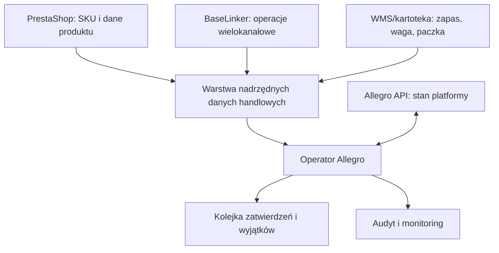

# Mapa systemu i odpowiedzialności

## Granice integracji

## Kto rozstrzyga poszczególne dane

| Obszar | Źródło nadrzędne | Kopia / cache | Uwagi |
|---|---|---|---|
| status oferty, produkt Allegro, walidacja kategorii | Allegro API | lokalna baza operatora | PrestaShop nie jest źródłem statusu Allegro. |
| SKU / `external.id` | kartoteka firmy | Allegro + operator | stabilny klucz do powiązania kanałów; nie używać tytułu. |
| zapas dostępny do sprzedaży | jeden wybrany system magazynowy | kanały sprzedaży | nie wolno mieć dwóch równorzędnych źródeł zapasu. |
| cena bazowa i granice ceny | ERP/PrestaShop lub zatwierdzony cennik | operator / kanały | Allegro może mieć kanałową cenę i promocję, ale zmiana musi mieć powód. |
| pełny koszt i marża | księgowość/ERP + rozliczenia Allegro/przewoźników | operator, wersja czasowa | brak kosztu oznacza `UNKNOWN`, nie zero. |
| waga i wymiary paczki | zweryfikowana kartoteka logistyczna SKU | operator | sugestia Allegro/AI nie jest dowodem. |
| kategoria i parametry wymagane | runtime Allegro API | cache z wersją i datą | zmieniają się bez zmiany kodu aplikacji. |
| tytuł, opis i układ zdjęć | zatwierdzony szablon firmy + reguły Allegro | oferta | stara oferta jest materiałem wejściowym, nie prawdą. |
| GTIN/EAN | producent/GS1 + Katalog Allegro | kartoteka | nie generować ani nie zgadywać. |
| GPSR / CLP / pasze | dokumenty producenta i obowiązujące prawo | repo dokumentów zgodności | agent nie tworzy deklaracji prawnej z tekstu marketingowego. |
| stan zamówienia i anulowanie | Allegro API / zdarzenia | lokalny model zdarzeń | zdarzenia mogą być opóźnione i poza kolejnością. |
| numer przesyłki i status nadania | API przewoźnika / Wysyłam z Allegro | operator, Allegro | tworzenie musi być idempotentne. |

## Konta Allegro

Każde konto przechowujemy jako oddzielny `seller_account`, ale reguły duplikatów i ryzyka biznesowego liczymy w obrębie całej grupy powiązanych kont. Nie wolno zakładać, że nowe konto zeruje limity lub historię produktu.

Minimalne dane konta:

- `seller_id`, login wyłącznie do wyświetlania, typ konta i marketplace;
- `client_id_ref` — odwołanie do sekretu, nigdy sekret;
- zakresy OAuth i czas ostatniego poprawnego odświeżenia;
- identyfikator grupy powiązanych kont;
- tryb `read_only`, `approval_required` lub jawna allowlista automatyzacji;
- właściciel biznesowy i kanał alertów.

## Moduły domenowe

| Moduł | Czyta | Zapisuje | Najważniejszy bezpiecznik |
|---|---|---|---|
| Identity | profil, aplikacja, token metadata | token w sejfie | minimalne scope i rotacja |
| Offer Inventory | oferty, events, unfilled parameters | lokalny snapshot | pełny backfill + kursor zdarzeń |
| Offer Studio | produkt, kategoria, szablony | draft/propozycja | diff i zatwierdzenie |
| Policy Engine | oferta + dokumenty | wynik reguł | blokada przy braku dowodów |
| Order Intake | order events, checkout forms | model zamówienia | deduplikacja i `READY_FOR_PROCESSING` |
| Shipment Desk | delivery proposals, shipment status | przesyłka/etykieta | trwały command UUID i kontrola paczki |
| Change Watch | Swagger, news, changelog | alert/issue | test regresji przed wdrożeniem zmiany |
| Audit | wszystkie działania | append-only log | redakcja danych osobowych |
| Cost & Quality | rozliczenia, Ads, Smart, KPI | koszt historyczny, alert | blokada niepełnej/ujemnej ekonomii |

## Antywzorce

- synchronizacja „ostatni zapis wygrywa” pomiędzy Allegro, BaseLinkerem i PrestaShop;
- identyfikowanie SKU tytułem oferty;
- pełna kopia odpowiedzi Allegro do nowego requestu;
- ciągłe odpytywanie całej listy ofert bez eventów i limitów;
- automatyczne wznowienie każdej zakończonej oferty bez sprawdzenia powodu;
- przechowywanie tokenów w `.env` na wspólnym dysku lub w logach;
- łączenie danych osobowych kupujących z długoterminową analityką produktu.
- optymalizacja przychodu/ROAS bez kosztu Smart, zwrotów, pakowania i promocji.
