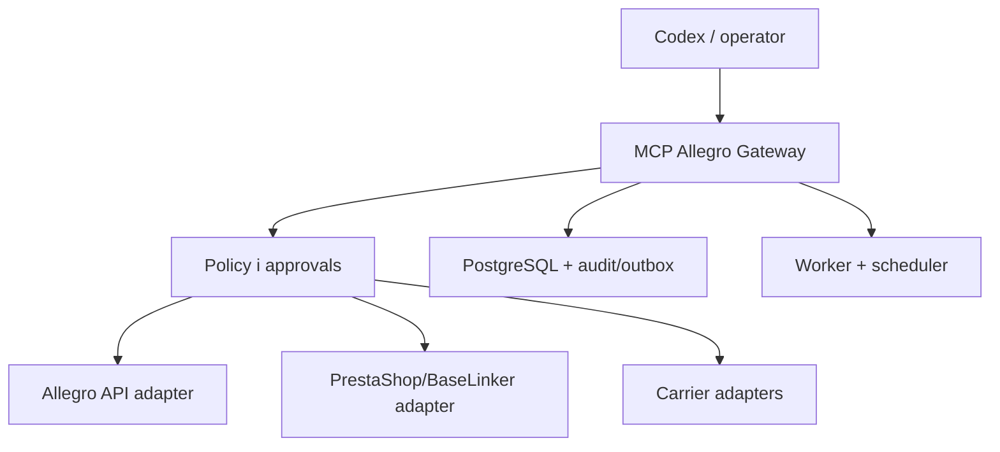

# Architektura operatora Allegro

Docelowa „wtyczka” powinna być własnym serwerem MCP/API nad integracją Allegro, a nie agentem sterującym panelem bez modelu danych. Nie ma zainstalowanej gotowej wtyczki Allegro obejmującej oferty, Smart, koszty, przesyłki i polityki RaFish. GitHub służy do utrzymania kodu i wiedzy; nie zastępuje dostępu do Allegro.

## Moduły

| Moduł | Odpowiedzialność | Nie może robić |
|---|---|---|
| `identity-auth` | OAuth, zakresy, rotacja tokenów, mapowanie kont | ujawniać sekretów agentowi |
| `allegro-client` | HTTP, media types, User-Agent, limity, Trace-Id | bezmyślnie ponawiać POST |
| `catalog` | kategorie, produkty, parametry, GTIN, cache z wersją | zgadywać parametru bez źródła |
| `offer-normalizer` | stara oferta → neutralny szablon → propozycja | kopiować pola serwerowe i compliance 1:1 |
| `offer-policy` | tytuł, zdjęcia, GPSR/CLP/pasze/AI/duplikaty | publikować po ostrzeżeniu blokującym |
| `inventory-pricing` | zapas master, ceny, pełny koszt i minimum marży | mieszać brutto z netto |
| `order-ingest` | events, reconciliation, READY, połączenia zamówień | przetwarzać event dwa razy |
| `shipment-orchestrator` | proposals, paczki, labels, pickup, tracking | przyjmować masę sugerowaną przez AI |
| `returns-quality` | zwroty, SLA, reklamacje, KPI, wyjątki | automatycznie odmawiać zwrotu |
| `ads-analytics` | import raportów, atrybucja, rekomendacja budżetu | oceniać tylko po przychodzie/ROAS |
| `approvals-audit` | diff, decyzja człowieka, outbox, dowód wyniku | pozwalać na niejawny zapis |

## Granice systemów

Przed kodowaniem utwórz macierz `field_ownership`: dla `stock`, `purchase_cost`, `price`, `handling_time`, `product_data`, `tracking`, `invoice` i `return_status` wskaż jeden system master oraz kierunek synchronizacji. Allegro jest źródłem zamówienia i stanu oferty na platformie; nie musi być źródłem zapasu ani kosztu zakupu.

## Technologia referencyjna

- TypeScript lub Python dla MCP/API;
- PostgreSQL dla stanu, blokad, audytu i wersjonowania;
- kolejka/outbox dla niezawodnych zadań;
- obiektowy magazyn dokumentów dla etykiet i dowodów, z krótką retencją i kontrolą dostępu;
- manager sekretów dla OAuth/ShipX;
- scheduler: szybkie zdarzenia + pełne okresowe uzgodnienie;
- obserwowalność: `operationId`, `Trace-Id`, konto, zasób, latency, retry i wynik bez PII.

## Środowiska

1. `docs`: bez sekretów i wywołań produkcyjnych.
2. `sandbox`: osobna aplikacja, konto i dane testowe.
3. `shadow`: produkcyjny read-only, porównuje bez zapisu.
4. `proposal`: generuje diff i oczekuje zatwierdzenia.
5. `limited-write`: mały zakres SKU/konta, limity dzienne i kill switch.
6. `production`: dopiero po testach regresji i akceptacji ryzyka.

## Stan agentowy

Agent nie przechowuje stanu transakcji wyłącznie w rozmowie. Każda operacja ma trwały rekord: wejście, wersję reguł, dane źródłowe, propozycję, walidacje, zgodę, UUID, status zewnętrzny, `Trace-Id`, wynik uzgodnienia i koszt.
